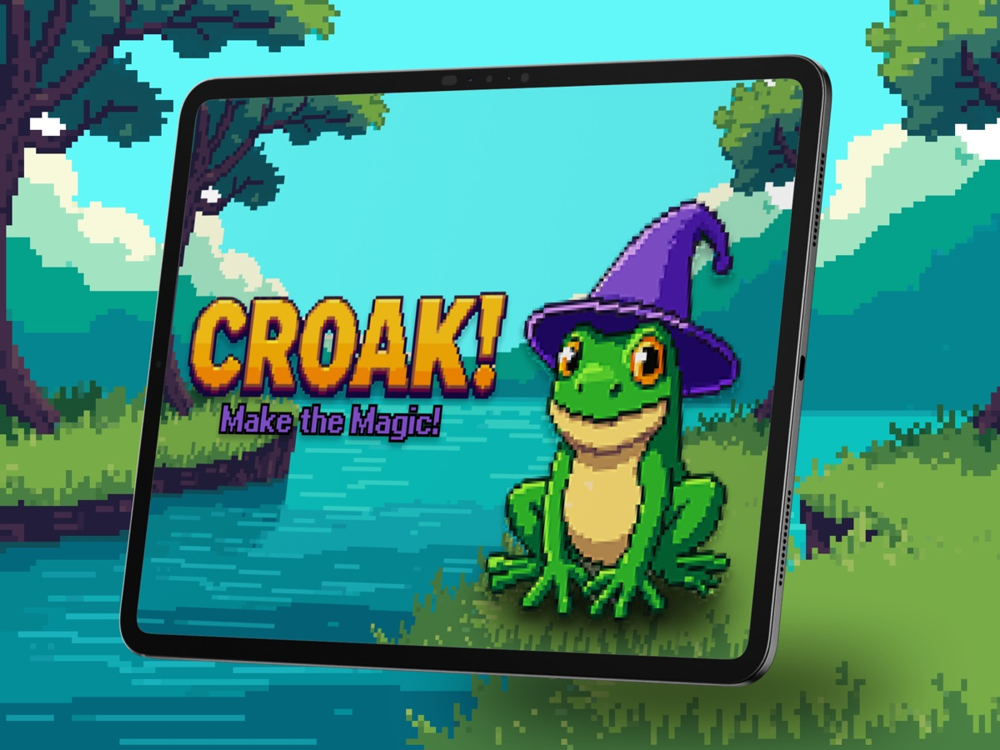
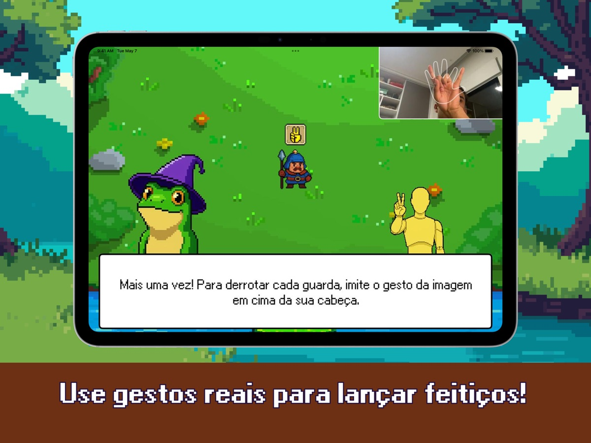
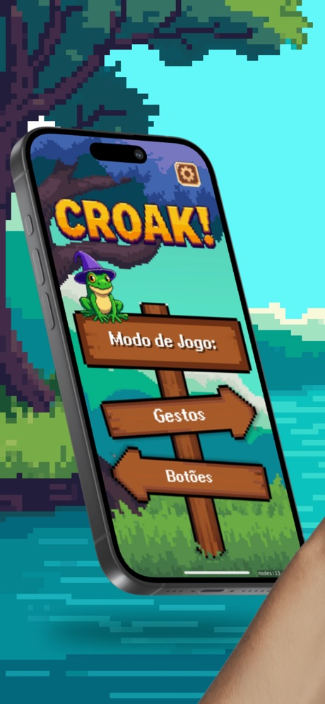
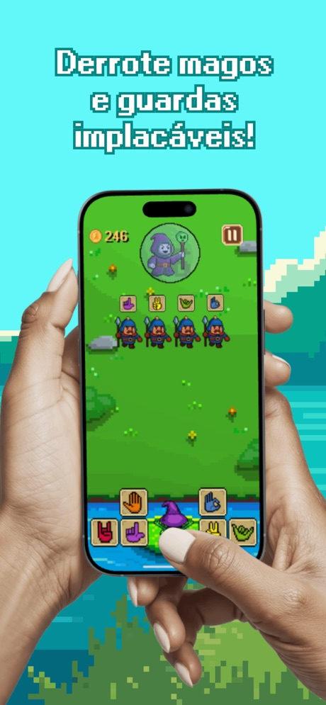
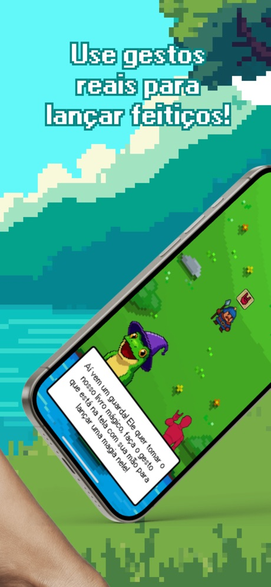
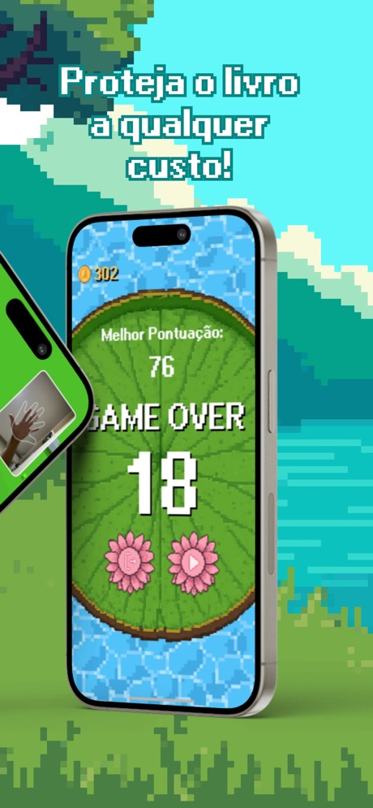

<div align="center">


# Croak: Make The Magic

**Seus gestos de mão viram feitiços.**

Jogo de ação para iPhone e iPad em que um sapo mago enfrenta hordas de inimigos.
A câmera frontal lê a sua mão em tempo real e um modelo de Machine Learning treinado pelo time
reconhece qual feitiço você está lançando.

[](https://apps.apple.com/br/app/croak-make-the-magic/id6752270992)
-F5B301)


</div>

<p align="center">
  
  
</p>

> [!NOTE]
> Projeto desenvolvido na **Apple Developer Academy | UCB** e publicado na App Store, com
> **nota 4,9** dada pelos jogadores.

---

## 🔒 Privacidade por design

- 📷 A câmera é usada **só** para detectar a pose da mão, quadro a quadro, no próprio aparelho.
- 🙅 Nenhuma imagem ou vídeo é gravado, salvo ou enviado para fora do dispositivo.
- 🎮 Progresso, moedas e recordes ficam salvos localmente; o ranking usa o Game Center.
- 📄 Política de privacidade: [daniellealpimenta.github.io/CroakSuport](https://daniellealpimenta.github.io/CroakSuport/suport)

## ✨ O que ele faz

| | |
|---|---|
| ✋ **Gestos viram feitiços** | Seis gestos reconhecidos: `Rock`, `Two`, `L`, `HangLose`, `OpenPalm` e `Top` |
| 🧠 **ML no aparelho** | Vision extrai os pontos da mão e um classificador Core ML (Create ML) decide o gesto |
| 🎯 **Precisão** | Só aceita o gesto com confiança ≥ 95% e estável num buffer de 5 quadros |
| 🟢 **Feedback visual** | A mão na tela fica branca, verde (acertou) ou vermelha (errou) |
| 🛡️ **Guardas** | Pedem um gesto aleatório para serem derrotados |
| 🦹 **Ladrões** | Exigem um combo de gestos em sequência |
| 🧙 **Mago chefe** | Batalha de chefe com vida própria e música própria |
| 🔘 **Modo Botões** | Joga sem câmera, com botões na tela (acessibilidade e locais sem luz) |
| 🏆 **Game Center** | Ranking global de pontuação |
| 🌍 **4 idiomas** | Português, inglês, espanhol e chinês simplificado |
| 📱 **iPhone e iPad** | Cenas e menus próprios para cada tamanho de tela |

## 📸 Telas

<table>
  <tr>
    <td width="25%"><br/><sub><b>Menu</b>: escolha entre Gestos e Botões</sub></td>
    <td width="25%"><br/><sub><b>Batalha</b>: guardas pedem gestos, o mago chefe espera</sub></td>
    <td width="25%"><br/><sub><b>Onboarding</b>: o sapo ensina o primeiro feitiço</sub></td>
    <td width="25%"><br/><sub><b>Game over</b>: pontuação e recorde</sub></td>
  </tr>
</table>

## 🧠 Como o reconhecimento funciona

```
Câmera frontal (AVCaptureSession, 640x480)
        │  CMSampleBuffer
        ▼
VNDetectHumanHandPoseRequest  ──►  21 pontos da mão (x, y, confiança)
        │  MLMultiArray
        ▼
GesturePredictor (Core ML)    ──►  rótulo + probabilidades
        │  confiança ≥ 0.95 e estável em 5 quadros
        ▼
GestureDetectionDelegate      ──►  a cena aplica o feitiço no inimigo da vez
```

- Dois modelos treinados no Create ML (`MLModelPrime` e `JPModel`) atrás de um mesmo protocolo,
  `GesturePredictor`, escolhidos conforme a versão do iOS: veja
  [`GesturePredictor.swift`](Magic%20Sapo/Control/GestureDetection/GesturePredictor.swift).
- O processamento roda numa fila própria (`cameraQueue`) para não travar o loop do SpriteKit.

## 🧱 Estrutura

```
Magic Sapo/
├── Scenes/             cenas SpriteKit: Loading, Menu (iPhone/iPad), Game, ButtonMode, GameOver
├── Components/         sapo, livro mágico, inimigos (Guarda, Ladrão, Mago), HUD, pausa, ajustes
├── Control/
│   ├── GestureDetection/   câmera + Vision + Core ML
│   ├── EnemyControl/       spawner, dificuldade e lógica do chefe
│   ├── AudioControl/       músicas e efeitos
│   └── Onboard/            tutorial da primeira partida
├── Helper/             Game Center e detecção de dispositivo
├── Util/               modelos .mlmodel
└── Resources/          assets, fontes, músicas e traduções (pt-BR, en, es, zh-Hans)
```

## 🚀 Primeiros passos

1. Clone e abra no Xcode 16 ou superior:

```bash
git clone https://github.com/daniellealpimenta/Croak.git
open "Croak/Magic Sapo.xcodeproj"
```

2. Escolha o seu time em *Signing & Capabilities* (o Game Center precisa de um time válido).
3. Rode num **aparelho físico**: o simulador não tem câmera, então lá só funciona o modo Botões.

> [!TIP]
> Requer iOS 18.5+. Para testar o reconhecimento, jogue com boa iluminação e a mão inteira
> visível no quadro.

## 👥 Time

Desenvolvido na Apple Developer Academy | UCB por **Daniel Leal Pimenta**, Pedro Henrique de
Santana Rocha Santos, João Paulo Albuquerque de Almeida Marques, Giovanna de Oliveira Macêdo e
Enzo Henrique Romão, com orientação de Júlio Santos e Nadja Caldeira.

## 🗺️ Roadmap

- [x] Reconhecimento de 6 gestos com Vision + Core ML
- [x] Guardas, Ladrões com combo e Mago chefe
- [x] Modo Botões, Game Center e 4 idiomas
- [x] Publicação na App Store
- [ ] Novos feitiços e inimigos
- [ ] Testes de unidade para spawner e regras de pontuação

## ⚖️ Licença

Código disponível apenas para portfólio e demonstração. Uso comercial, cópia ou redistribuição
dependem de autorização do autor. Veja [`LICENSE`](LICENSE).
